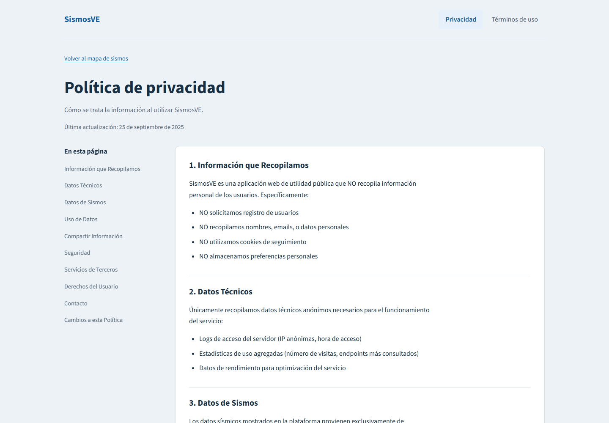
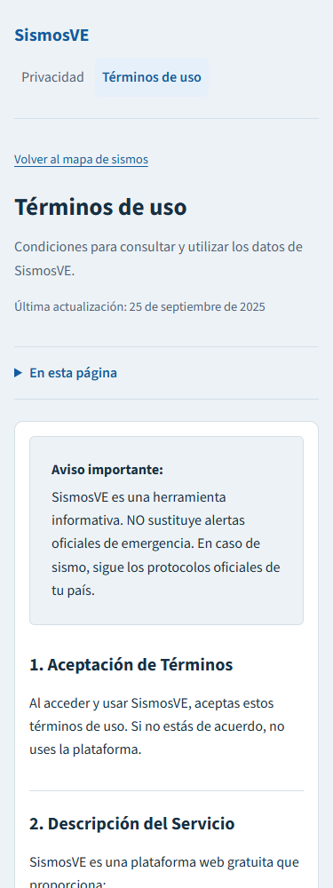
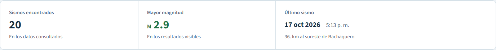
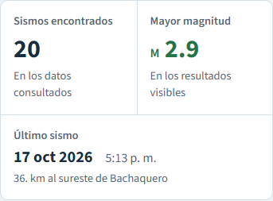

# Validación del refactor Svelte

## Problemas corregidos
- La selección por índice no coincidía con el orden cronológico del listado.
- Una colección vacía se rechazaba como inválida.
- El respaldo repetía la misma llamada HTTP fallida.
- Los filtros anunciados no estaban implementados.
- Robots contenía Jinja sin resolver; sitemap y metadatos usaban distintos dominios.
- Los recursos sociales e iconos referenciados no existían en el repositorio.

## Arquitectura
FastAPI/Jinja entrega HTML con SEO, encabezado, descripción y CTA de FUNVISIS.
Svelte 5 controla la herramienta con Leaflet, TypeScript y un build Vite.
La API y los módulos anteriores se conservan; la página deja de cargar estos últimos.
Los datos se consultan cada cinco minutos y se retienen en memoria al fallar una
actualización. Exportación, mapa, estadísticas y listado comparten los filtros.

## Evidencia local
- `npm run check`: sin errores ni advertencias.
- `npm test`: seis pruebas de datos y solicitudes.
- `npm run build`: build de producción correcto.
- `python -m pytest test_app.py test_ui.py -q`: seis pruebas de API, SEO y recursos.
- Playwright en Edge: datos reales, selección mapa/lista, filtros combinados,
  fechas inclusivas, rango inválido, descarga JSON, fallos GET y de actualización,
  conservación de datos, colección vacía, teclado y movimiento reducido.
- Sin desbordamiento horizontal en 320, 375, 414, 768, 1280 y 1440 px.
- Imagen Docker construida y contenedor con respuesta `status=healthy`, scheduler
  funcionando y datos actuales descargados desde FUNVISIS.

El caso HTTP 503 se simula en el navegador; su error de red en consola es esperado.
FastAPI/Starlette emite una advertencia de deprecación sobre su adaptador httpx;
las pruebas pasan. La validación Docker local corresponde a linux/amd64; CI
mantiene el build para amd64 y arm64.

## Capturas


## Revisión manual
Abrir http://localhost:8001. El contenedor `sismosve-svelte-review` usa una copia
de datos independiente. Consultar logs y detenerlo con:

```sh
docker compose -f docker-compose.local.yml logs -f
docker compose -f docker-compose.local.yml stop
```


## Páginas legales

Privacidad y términos comparten la tipografía local, los colores y los controles
del monitor. Incluyen navegación entre documentos, índice lateral en escritorio,
índice desplegable nativo en móvil, enlaces a cada sección, acceso al mapa y
estilos de impresión. Sus URLs, descripciones SEO, contenido legal y fecha
original de actualización se conservan. No cargan JavaScript.

Vite genera `static/ui/legal.css` con los tokens y fuentes locales. El archivo
se referencia directamente desde ambos documentos estáticos, sin cargar el
bundle del mapa. Sus dependencias tipográficas conservan nombres versionados.

Validación adicional: comparación del contenido de ambos documentos con la
versión anterior; Playwright en 320, 375, 414, 768, 1280 y 1440 px sin overflow;
índices, navegación entre documentos, enlaces al mapa, foco de teclado, modo
impresión y contenido disponible sin JavaScript. Svelte check, build Docker y
las seis pruebas existentes de API/SEO también pasan.





## Resumen de resultados

El resumen agrupa cantidad, mayor magnitud y último evento en una franja con
separadores. Las etiquetas preceden a los valores; la magnitud usa el mismo
código de color del mapa. El último sismo incluye fecha legible, hora de la
fuente y ubicación. En móvil ocupa una fila completa bajo los dos números.
Al filtrar se indica cuántos registros se muestran respecto del total consultado.

Los estados de carga inicial, error sin datos y fechas inválidas muestran un
guion en vez de un cero ficticio. Una búsqueda vacía muestra cero registros y
ninguna magnitud o fecha. Si falla la recarga, se conservan los últimos valores.
Los cambios de cantidad se anuncian de forma accesible sin mover el foco.

Validación: Svelte check, build y pruebas existentes correctos; Playwright
verifica los valores con datos controlados, fecha/hora sin conversión de zona,
filtros combinados, ausencia de resultados, rango inválido, carga inicial y
fallos con/sin datos previos. Revisado en 320, 375, 414, 768, 1280 y 1440 px sin
desbordamiento. Docker reconstruido y dejado en ejecución.




## Persistencia del JSON

API y actualizadores comparten `DATA_FILE=/app/data/sismosve.json` en Docker.
El volumen de revisión es `sismosve-review-data`, separado del código; el de
Dokploy existente se reutiliza mediante su montaje en `/app/data`.
El usuario de runtime tiene UID/GID estables `10001:10001` y las dependencias
están en `/opt/venv`, también accesibles para el contenedor auxiliar de restauración.

El arranque valida y conserva el JSON existente. Las actualizaciones posteriores
usan reemplazo atómico y mantienen hasta cinco respaldos en el mismo volumen.
La [guía de migración](PERSISTENT_DATA.md) contiene los comandos para el volumen
ya creado, sin montar ni cambiar permisos sobre `/app`.

Validación: 21 pruebas Python pasan en Windows y dentro de la imagen Python 3.14.
Cubren inicialización única, archivo corrupto, permisos, fallos de reemplazo,
respaldos y su retención, formato FUNVISIS y descarga fallida. Se migró el JSON
de revisión conservando su hash al arrancar; después de una escritura real se
recreó el contenedor y se verificó que JSON y respaldos conservaran sus hashes.
Una actualización manual real desde FUNVISIS también guardó los datos y su
respaldo en el volumen. La instancia queda saludable en localhost:8001.

## Observaciones de Copilot

- [Permisos del archivo en Linux](https://github.com/rafnixg/sismosve/pull/21#discussion_r4304711173):
  el bind mount del archivo fue reemplazado en `d4ea457` por un volumen de datos.
  La imagen usa UID/GID `10001:10001`. Además de la migración de revisión, se
  verificó un volumen nuevo en Docker Linux: el usuario de runtime inicializa,
  escribe y genera el respaldo sin privilegios. Los volúmenes existentes siguen
  el ajuste de permisos documentado en la guía de migración.
- [Reintentar la operación fallida](https://github.com/rafnixg/sismosve/pull/21#discussion_r4304711199):
  se conserva la etapa que falló (actualización o lectura). Un fallo del POST
  repite la actualización; un fallo de lectura repite el GET. Si el POST ya tuvo
  éxito y falla el GET posterior, el reintento no duplica la actualización.
- [Desplazamiento al seleccionar un marcador](https://github.com/rafnixg/sismosve/pull/21#discussion_r4304711221):
  se desplaza únicamente `.event-list` hasta la fila seleccionada. Se comprobó
  que `window.scrollY` permanece igual y el popup del mapa sigue visible a 375,
  768 y 1440 px, tanto al buscar una fila inferior como una superior.

Las regresiones de reintento y desplazamiento se pueden repetir con Playwright
CLI, después de arrancar la instancia local y abrir el navegador:

```sh
npx --yes --package @playwright/cli playwright-cli open http://localhost:8001 --browser msedge
npx --yes --package @playwright/cli playwright-cli run-code --filename frontend/checks/review-regressions.js
```

Los fallos HTTP se simulan en el navegador y se contabilizan los GET/POST para
verificar la operación repetida. Las rutas simuladas se retiran al terminar.
