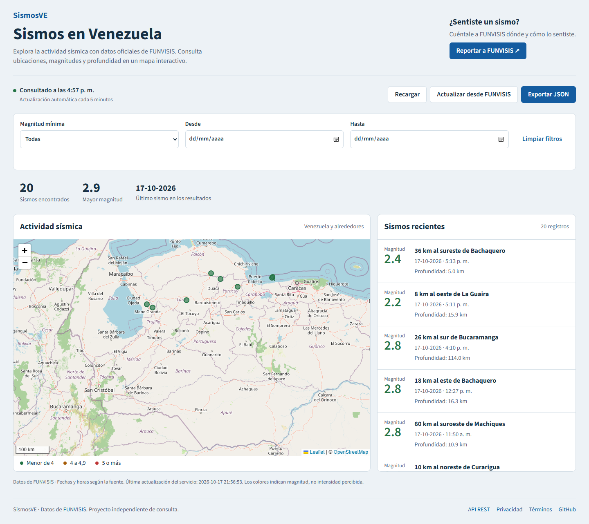
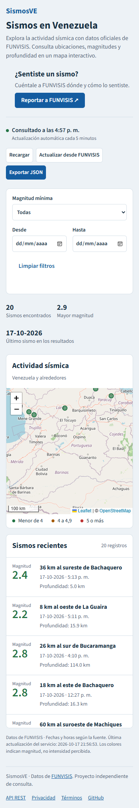

# Validación del refactor Svelte

## Problemas corregidos
- La selección por índice no coincidía con el orden cronológico del listado.
- Una colección vacía se rechazaba como inválida.
- El respaldo repetía la misma llamada HTTP fallida.
- Los filtros anunciados no estaban implementados.
- Robots contenía Jinja sin resolver; sitemap y metadatos usaban distintos dominios.
- Los recursos sociales e iconos referenciados no existían en el repositorio.

## Arquitectura
FastAPI/Jinja entrega HTML con SEO, encabezado, descripción y CTA de FUNVISIS.
Svelte 5 controla la herramienta con Leaflet, TypeScript y un build Vite.
La API y los módulos anteriores se conservan; la página deja de cargar estos últimos.
Los datos se consultan cada cinco minutos y se retienen en memoria al fallar una
actualización. Exportación, mapa, estadísticas y listado comparten los filtros.

## Evidencia local
- `npm run check`: sin errores ni advertencias.
- `npm test`: seis pruebas de datos y solicitudes.
- `npm run build`: build de producción correcto.
- `python -m pytest test_app.py test_ui.py -q`: seis pruebas de API, SEO y recursos.
- Playwright en Edge: datos reales, selección mapa/lista, filtros combinados,
  fechas inclusivas, rango inválido, descarga JSON, fallos GET y de actualización,
  conservación de datos, colección vacía, teclado y movimiento reducido.
- Sin desbordamiento horizontal en 320, 375, 414, 768, 1280 y 1440 px.
- Imagen Docker construida y contenedor con respuesta `status=healthy`, scheduler
  funcionando y datos actuales descargados desde FUNVISIS.

El caso HTTP 503 se simula en el navegador; su error de red en consola es esperado.
FastAPI/Starlette emite una advertencia de deprecación sobre su adaptador httpx;
las pruebas pasan. La validación Docker local corresponde a linux/amd64; CI
mantiene el build para amd64 y arm64.

## Capturas



## Revisión manual
Abrir http://localhost:8001. El contenedor `sismosve-svelte-review` usa una copia
de datos independiente. Consultar logs y detenerlo con:

```sh
docker compose -f docker-compose.local.yml logs -f
docker compose -f docker-compose.local.yml stop
```
